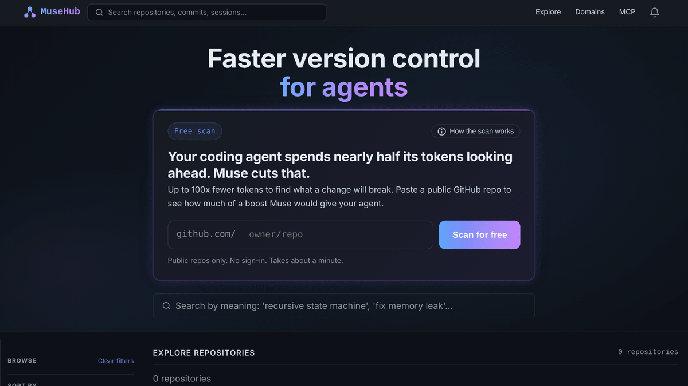
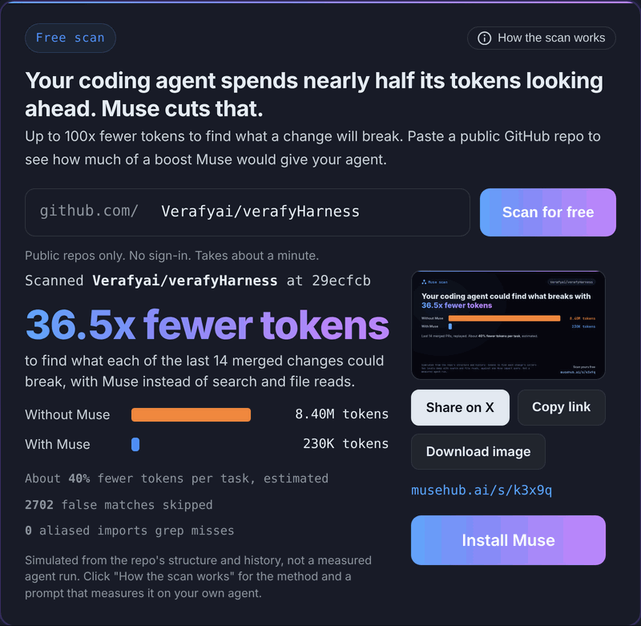
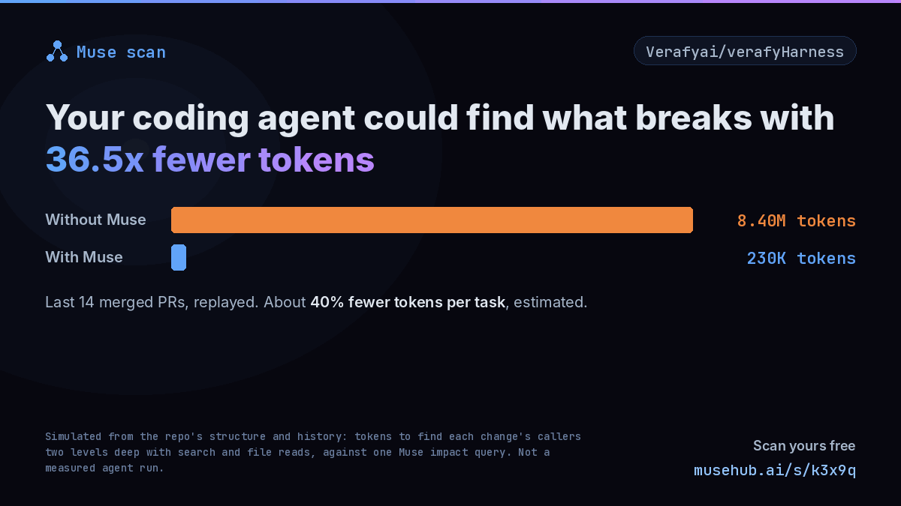

# MuseHub


[](LICENSE)

**Faster version control for agents.**

Before every change, a coding agent has to work out what that change could break. With Git, it greps for callers and reads every file that mentions them. That reading and searching is nearly half of an agent's tokens: 46.5% in a 300-run study (Zhang et al. 2026, arXiv 2606.14066).

Muse tracks functions and the code that calls them, not lines of text. So "what breaks if I change this?" is one `muse code impact --json` call instead of dozens of searches and file reads. On the "what breaks" question, that is up to 100x fewer tokens.

MuseHub is the hub for Muse repos. It lets you:

- push commits;
- open pull requests;
- track issues;
- publish releases;
- give agents full programmatic access over MCP.

## Free scan: how much would Muse save your agent?

The homepage has a free scan: paste any public GitHub repo, and MuseHub replays its last 20 merged pull requests. For every function they changed, it counts the tokens needed to find its callers two levels deep, both ways: with search and file reads, and with one Muse impact query.



Every result gets:

- a short URL;
- a share image sized for X;
- an **Install Muse** button;
- a **How the scan works** button. It shows the method and a prompt you can give your own agent to measure the gain for real, instead of simulating it.

| Result | Share image |
|---|---|
|  |  |

The scan is a simulation from the repo's code and history, and every result says so. Method, files and deployment notes are in [docs/scan/README.md](docs/scan/README.md).

> **Requirements:** Python 3.14+, PostgreSQL 16+, Node.js 22+. The share image needs Pillow. Scans need `GITHUB_TOKEN`, a read-only token for public repos.

## URL scheme

```
/{owner}/{slug}           →  repo home page
musehub://{owner}/{slug}  →  MCP resource URI (see MCP docs)
```

## Architecture

```
musehub/
  api/routes/musehub/   44 route handlers (thin HTTP)
  api/routes/mcp.py     POST /mcp — HTTP Streamable MCP endpoint
  services/             26 musehub_*.py business logic modules
  db/                   SQLAlchemy ORM models (Postgres)
  models/               Pydantic request/response models
  mcp/
    dispatcher.py       Async JSON-RPC 2.0 engine (no SDK dependency)
    tools/              40-tool catalogue (20 read + 15 write + 5 elicitation)
    resources.py        29 musehub:// resources (12 static + 17 templated)
    prompts.py          10 workflow prompts
    write_tools/        Write executor modules (repos, issues, PRs, releases, social)
    stdio_server.py     stdio transport for local dev / Cursor IDE
  templates/musehub/    Jinja2 + HTMX + Alpine.js web UI
  auth/                 JWT auth dependencies
  config.py             Pydantic Settings (env vars)

tools/
  typing_audit.py       Static typing violation scanner (ratchet-safe)
```

## Running locally

```bash
# Start with Docker Compose (Postgres + app)
docker compose up -d

# Run Alembic migrations
docker compose exec musehub alembic upgrade head

# Seed development data
docker compose exec musehub python3 scripts/seed_musehub.py
```

## API

Interactive docs available at `/docs` when `DEBUG=true`.

OpenAPI spec always available at `/api/v1/openapi.json`.

## Auth

Write endpoints and private-repo reads require:

```
Authorization: Bearer <jwt>
```

Public repo reads and all MCP read tools are unauthenticated. MCP write tools require the same JWT in the `Authorization` header.

---

## MCP Integration

MuseHub implements the full [MCP 2025-11-25 specification](https://modelcontextprotocol.io/specification/2025-11-25) — no external MCP SDK, pure Python async. Agents get complete capability parity with the web UI.

### Transports

| Transport | Endpoint | Use case |
|-----------|----------|----------|
| HTTP Streamable | `POST /mcp` | Production; any MCP client |
| stdio | `python -m musehub.mcp.stdio_server` | Local dev, Cursor IDE |

**Cursor IDE integration** — add to `.cursor/mcp.json`:

```json
{
  "mcpServers": {
    "musehub": {
      "command": "python",
      "args": ["-m", "musehub.mcp.stdio_server"],
      "cwd": "/path/to/musehub"
    }
  }
}
```

### Tools — 40 total

**Read tools (20):** list branches, list/get commits, compare refs, read files, search in-repo, list/get issues, list/get PRs, list releases, search public repos, get full AI context, get domain info, get domain insights, get dimension view, list domains, get whoami, muse pull, muse remote.

**Write tools (15):** create/fork repos, create/update issues, comment on issues, create/merge PRs, inline PR comments, submit PR reviews, create releases, star repos, create labels, create agent token, muse push, muse config.

**Elicitation-powered tools (5, MCP 2025-11-25):** interactive creation planner, interactive PR review, streaming platform OAuth connect, cloud DAW OAuth connect, interactive release creator.

> All repo-scoped tools accept either `repo_id` (UUID) or `owner` + `slug` (human-readable) — the dispatcher resolves transparently.

> Write and elicitation tools require `Authorization: Bearer <jwt>`. Elicitation tools also require an active session (`Mcp-Session-Id`). They degrade gracefully for stateless clients.

### Transports — Full Streamable HTTP (2025-11-25)

| Verb | Endpoint | Purpose |
|------|----------|---------|
| `POST` | `/mcp` | All client→server requests; SSE stream for elicitation-powered tools |
| `GET` | `/mcp` | Persistent SSE push channel for server→client notifications |
| `DELETE` | `/mcp` | Client-initiated session termination |
| stdio | `python -m musehub.mcp.stdio_server` | Local dev, Cursor IDE |

**Session lifecycle:** `POST initialize` → receive `Mcp-Session-Id` → include on all subsequent requests → `DELETE /mcp` to close.

### Resources — 29 total

Cacheable, URI-addressable reads via the `musehub://` scheme.

| URI | Description |
|-----|-------------|
| `musehub://trending` | Top public repos by star count |
| `musehub://me` | Authenticated user profile + pinned repos |
| `musehub://me/notifications` | Unread notification inbox |
| `musehub://me/starred` | Repos the user has starred |
| `musehub://me/feed` | Activity feed for watched repos |
| `musehub://repos/{owner}/{slug}` | Repo overview + stats |
| `musehub://repos/{owner}/{slug}/branches` | All branches |
| `musehub://repos/{owner}/{slug}/commits` | Commit list |
| `musehub://repos/{owner}/{slug}/commits/{commit_id}` | Single commit |
| `musehub://repos/{owner}/{slug}/tree/{ref}` | File tree at ref |
| `musehub://repos/{owner}/{slug}/blob/{ref}/{path}` | File metadata |
| `musehub://repos/{owner}/{slug}/issues` | Issue list |
| `musehub://repos/{owner}/{slug}/issues/{number}` | Issue + comment thread |
| `musehub://repos/{owner}/{slug}/pulls` | PR list |
| `musehub://repos/{owner}/{slug}/pulls/{number}` | PR + reviews |
| `musehub://repos/{owner}/{slug}/releases` | All releases |
| `musehub://repos/{owner}/{slug}/releases/{tag}` | Single release |
| `musehub://repos/{owner}/{slug}/analysis/{ref}` | Musical analysis |
| `musehub://repos/{owner}/{slug}/timeline` | Musical evolution timeline |
| `musehub://users/{username}` | User profile + public repos |

### Prompts — 10 total

Workflow guides that teach agents how to chain tools and resources:

| Prompt | Purpose |
|--------|---------|
| `musehub/orientation` | Essential onboarding for humans and agents; pass `caller_type: "agent"` for agent-specific guidance |
| `musehub/contribute` | End-to-end contribution: orient → issue → commit → PR → merge (includes auth/push setup) |
| `musehub/create` | Create a new Muse project from scratch with domain selection |
| `musehub/review_pr` | Musical PR review with track/region-level inline comments |
| `musehub/issue_triage` | Triage open issues: label, assign, link to milestones |
| `musehub/release_prep` | Prepare a release: merged PRs → release notes → publish |
| `musehub/onboard` | Interactive artist onboarding via elicitation |
| `musehub/release_to_world` | Full release + streaming distribution pipeline |
| `musehub/domain-discovery` | Discover and evaluate available domain plugins |
| `musehub/domain-authoring` | Author a new domain plugin from scratch |

### What an agent can do

```
1.  Discover repos     musehub://trending  or  musehub_search_repos
2.  Understand a repo  musehub_get_context → musehub://repos/{owner}/{slug}/analysis/{ref}
3.  Open an issue      musehub_create_issue
4.  Push a fix         musehub_get_context → compose MIDI → musehub_create_pr
5.  Review a PR        musehub_review_pr_interactive  (elicitation-powered)
6.  Create release     musehub_create_release_interactive  (form + platform OAuth)
7.  Build social graph musehub_star_repo, musehub_fork_repo
8.  Connect platforms  musehub_connect_streaming_platform  (Spotify, SoundCloud, …)
9.  Connect cloud DAW  musehub_connect_daw_cloud  (LANDR, Splice, Soundtrap, …)
10. Compose with AI    musehub_create_with_preferences  (interviews user, returns plan)
```

Full reference: [`docs/reference/mcp.md`](docs/reference/mcp.md)

---

## Developer Tools

```bash
# Type violation audit (ratchet at 0 violations)
python tools/typing_audit.py --dirs musehub/ tests/ --max-any 0

# With JSON output
python tools/typing_audit.py --dirs musehub/ tests/ --json artifacts/typing_audit.json
```

## License

Proprietary — Muse VCS.
