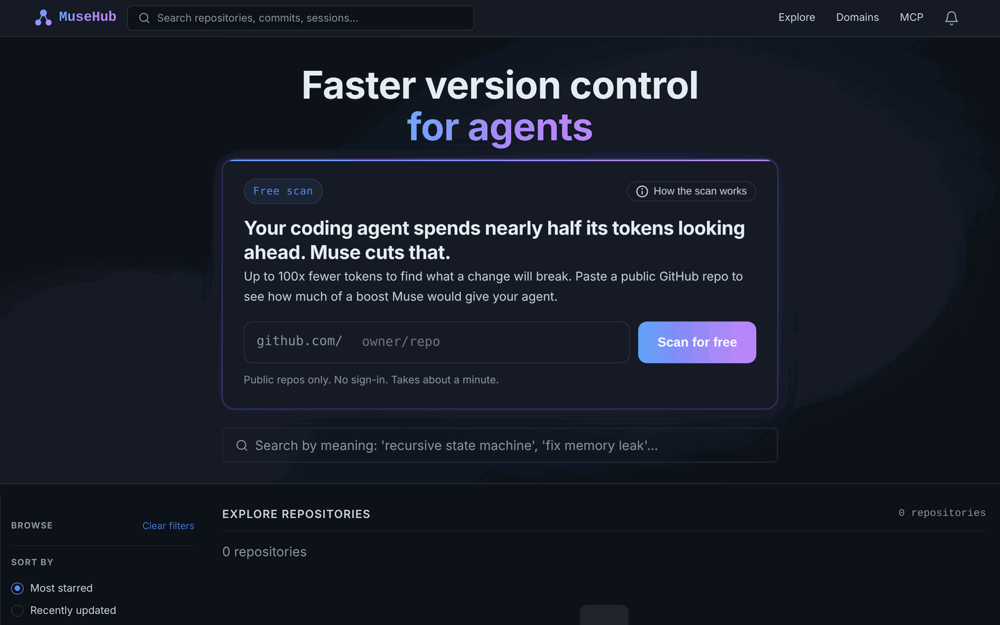
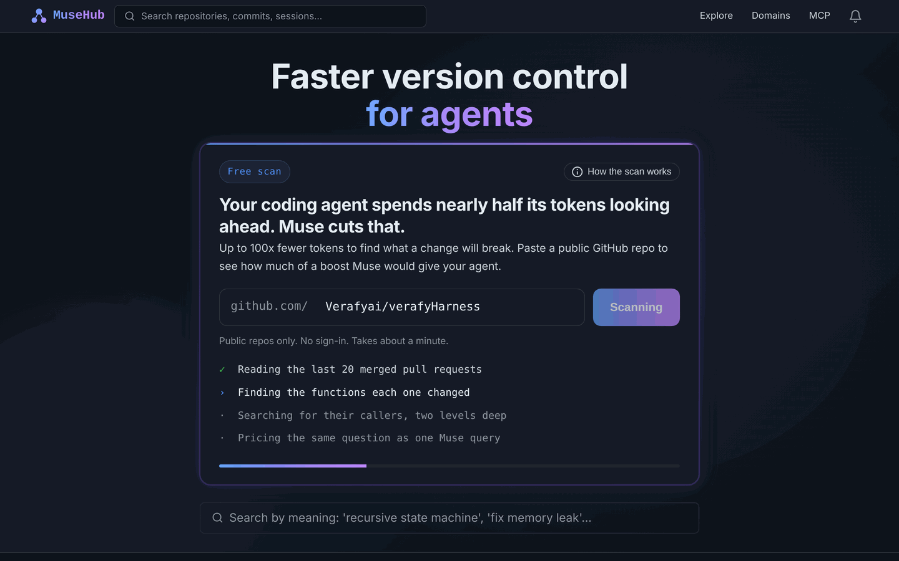
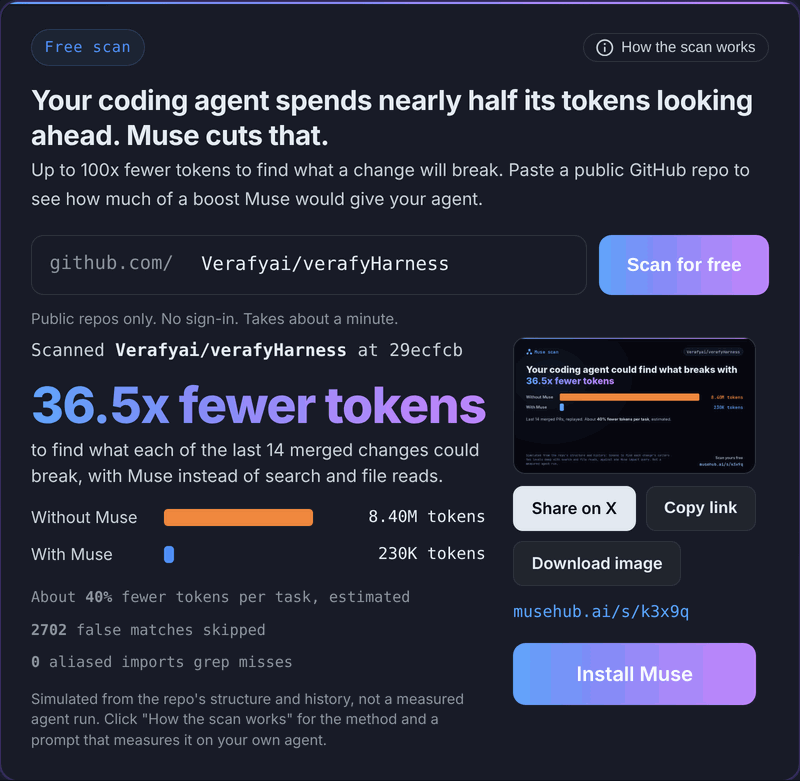
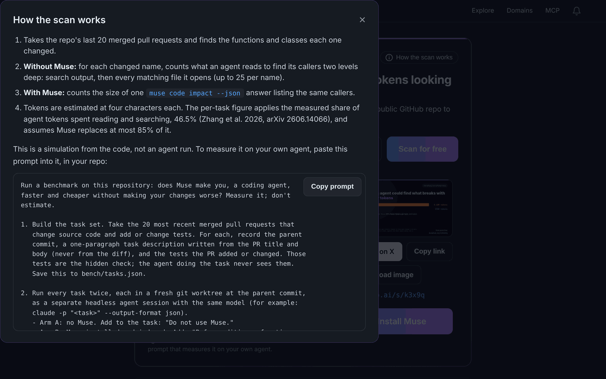
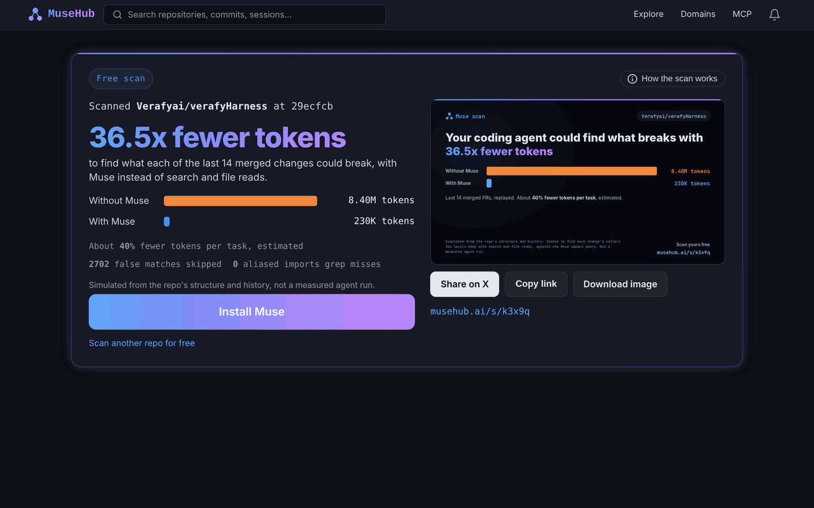
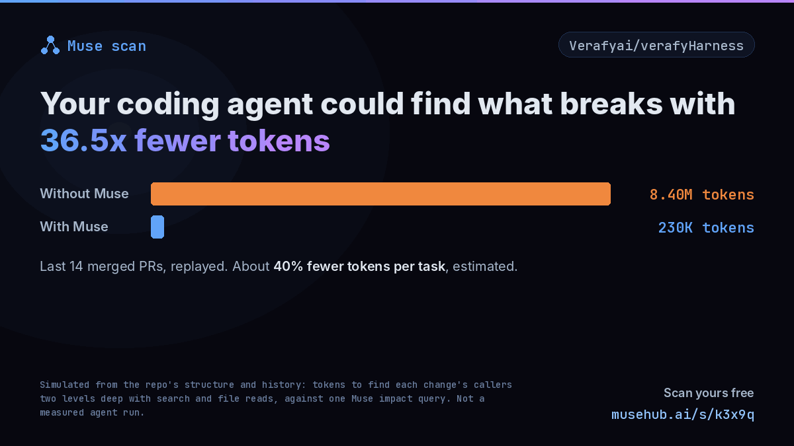
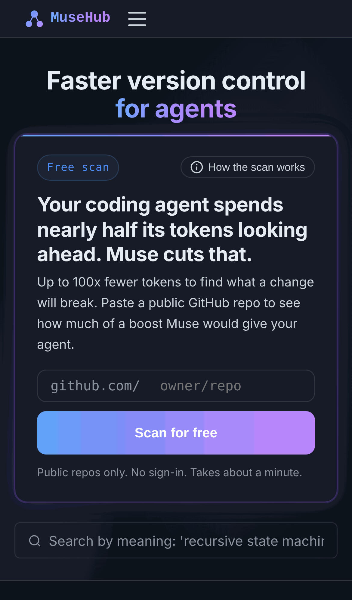

# Free scan: "Scan your code" on the homepage

## What it is

Coding agents spend nearly half their tokens reading and searching code. The measured figure is 46.5% of tokens (Zhang et al. 2026, "FastContext", arXiv 2606.14066). A large part of that is one question asked before every change: what will this break?

With grep and file reads, that question costs an agent hundreds of thousands of tokens. With Muse it is one `muse code impact --json` call.

This PR puts a free scan on the MuseHub homepage, above the fold, so anyone can see that difference on their own code:

1. Paste any public GitHub repo.
2. MuseHub replays its last 20 merged pull requests.
3. For each changed function, it prices "find the callers two levels deep" both ways: search plus file reads, against one Muse impact answer.
4. The result shows the ratio, the two token totals, an estimated per-task saving, and the false matches and aliased imports grep gets wrong.
5. Every result gets:
   - a short URL (`/s/{id}`);
   - a 1200×675 share image sized for X, with og:image tags so the link unfurls;
   - Share on X, Copy link and Download image buttons;
   - an **Install Muse** button.
6. A **How the scan works** button opens the method and the full benchmark prompt, with a copy button. Someone can paste that prompt into their own agent to measure the gain for real.

It also works for outbound: scan a prospect's repo and send them the link.

The homepage headline changes to "Faster version control for agents", and the subtitle under it is removed.

## Honesty, built in

- **Labeling.** Every result says "Simulated… not a measured agent run". The method is one click away.
- **The ratio.** It is a real count on the repo's own code, not a constant.
  - verafyHarness: 36.5x across 14 PRs.
  - svmLLM: 22.1x across 3 PRs.
- **The per-task estimate.** It is capped at 46.5% × 85% ≈ 40%, because the agent still reads the code it edits.
- **Small repos.** Where search is already cheap (ratio under 2x), the scan says so instead of printing a weak or inverted number.

## Screenshots

| | |
|---|---|
| Homepage, idle |  |
| Scanning |  |
| Result on the homepage |  |
| How the scan works (prompt) |  |
| Short URL page with Install Muse |  |
| Share image (1200×675) |  |
| Mobile |  |

The screenshots come from a local run of this branch with real scan data. `muse-free-scan.gif` is the whole flow as a 16:9 animation for X.

## How it works

`musehub/services/musehub_scan.py` is the only module that talks to GitHub for scans.

1. It gets the repo metadata, the head SHA and the last 20 merged PRs with their patches.
2. It downloads the default-branch tarball, keeping source files and skipping vendor and build directories and very large files.
3. It finds the changed symbols from hunk headers and from added or removed definitions.
4. **Without Muse:**
   - word-boundary search output;
   - every matching file read, capped at 25 per name;
   - then the enclosing functions of the callers, searched and read the same way (second level).
5. **With Muse:** a 120-token envelope plus 40 tokens per caller in the JSON answer.
6. Tokens are counted at 4 characters each.

The analysis is regex-based and language-agnostic on purpose: it runs on any public repo without installing a toolchain. It approximates Muse's symbol graph; it does not call it.

## Files

| File | What |
|---|---|
| `musehub/services/musehub_scan.py` | Simulation, GitHub client, in-memory result store, benchmark prompt |
| `musehub/services/musehub_scan_card.py` | Share image with Pillow (no browser) |
| `musehub/api/routes/musehub/ui_scan.py` | `POST /scan`, `GET /s/{id}`, `GET /s/{id}.png`, rate-limited 5/minute per IP |
| `templates/.../fragments/scan_card.html`, `scan_info.html` | Homepage card and the method dialog |
| `templates/.../pages/scan_result.html` | Short URL page with og:image and Install Muse |
| `static/js/pages/scan.ts`, `static/scss/_scan.scss` | Behaviour and styles; `app.js` and `app.css` rebuilt |
| `static/scss/_tokens.scss` | Adds the live site's spectral tokens, which this mirror lacked |
| `static/fonts/scan/` | Inter and JetBrains Mono for the share image (SIL OFL, licenses included) |
| `tests/test_musehub_scan.py` | 26 tests: parsing, costing, caps, image, routes, homepage render |
| `config.py`, `rate_limits.py`, `main.py`, `requirements.txt` | `GITHUB_TOKEN` setting, `SCAN_LIMIT`, router, Pillow |

## Before deploying

- **Set `GITHUB_TOKEN`.** Use a fine-grained token with public read access only. Unauthenticated GitHub allows 60 requests an hour, and one scan uses about 25.
- **Results live in memory.** A restart forgets short URLs. Persisting them needs a table and a migration, which AGENTS.md says to ask about first. That is the follow-up.
- **Scope note.** AGENTS.md says not to use GitHub for anything. That rule is about version control. The scanner reads GitHub because that's where prospects' code lives.

## Checks

- **`mypy`:** clean on every new module. The two errors left in `release_analysis.py` predate this PR; they come from the current `muse` package shipping without `py.typed`.
- **`pytest tests/`:** see the PR description for the latest run.
